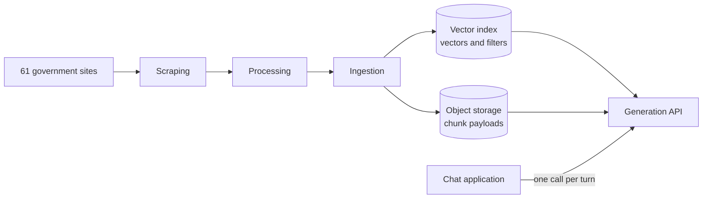
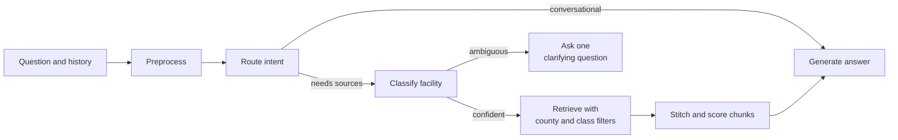

# GovAI RAG

Retrieval-augmented question answering over California environmental health regulations. It covers 61 jurisdictions and runs in production on Google Cloud.

> **This repository is a project overview.** GovAI is client work built by a small team, and its source code is private. This page describes what the system does and how it is engineered. It contains no code.

## The problem

Environmental health rules in California are set and published locally. A restaurant owner, a food-truck operator or a pool contractor has to find the right county department's website, then the right page or PDF, and then the paragraph that applies to them. There are 58 counties and three cities with their own health departments, and each one publishes differently: HTML pages, text PDFs, scanned PDFs, fillable forms.

GovAI collects those sources, turns them into a searchable index, and answers a question in plain language with citations to the documents it used. It scopes the answer to the user's county and to the kind of facility they are asking about.

## At a glance

| | |
|---|---|
| Coverage | 61 jurisdictions: 58 counties plus Berkeley, Long Beach and Pasadena |
| Corpus | More than 11,000 source documents, indexed as about 70,000 chunks |
| Interface | A stateless HTTP API that a separate chat application calls once per turn |
| Models | Gemini 2.5 Flash for generation and page understanding, Gemini Embedding for retrieval |
| Retrieval | Vertex AI Vector Search with county and facility-class filters |
| Runtime | Cloud Run, with a staging service and a separate staging index |
| Tests | About 340 automated tests, run on every push |

## Architecture

Four services, each owning one stage. The first three are offline batch jobs. Only the last one is a live service.

| Stage | What it does |
|---|---|
| **Scraping** | Discovers and downloads each jurisdiction's pages and PDFs with a headless browser, in parallel, one browser per worker. Per-site rules handle each site's navigation. Accordions and collapsed sections are expanded before a page is saved. A proxy API is the fallback for sites behind bot protection. |
| **Processing** | Converts HTML and PDFs to Markdown with a metadata file beside each document. HTML is stripped of navigation and boilerplate. Each PDF page is classified and sent to the cheapest parser that can extract it faithfully: plain text, tables, forms, or a vision model for pages that are mostly image. |
| **Ingestion** | Splits documents at structural boundaries (headings, table rows, prose blocks) instead of fixed lengths, and embeds the chunks. It then updates two stores together: the vector index, and a payload file that holds each chunk's full text and metadata. |
| **Generation** | Answers one chat turn. A six-step LangGraph pipeline classifies the question, retrieves and filters chunks, and writes the answer with citations. |

The generation service keeps no session state. The chat application owns users and history and sends the conversation with each call, so any instance can serve any request.

## How a question is answered

1. **Preprocess and route.** A follow-up such as "what about fees?" is rewritten into a standalone question using the conversation so far. Turns that need no sources are answered directly.
2. **Classify.** The system decides what kind of facility the question concerns: a permanent restaurant, a mobile food facility, a temporary event booth, a home kitchen, a pool, a body art studio. A fixed vocabulary is checked first. The model is consulted only when nothing matches, and its answer is validated against the allowed values.
3. **Retrieve.** The county is detected from the question or the conversation and applied as an index filter. A question that names several counties is searched per county and the results are merged with reciprocal rank fusion. Chunks that belong to a different facility class are removed.
4. **Assemble.** Documents that were split into parts are stitched back together, linked PDFs are pulled in, and chunks are scored on their metadata.
5. **Answer.** The answer is generated within a fixed context budget and returned with its citations.

Users can also attach up to three PDFs to a message. Their text is extracted and used for that one turn. It is never added to the index, and a file that cannot be read is named in the answer instead of failing the turn.

## Engineering problems worth describing

### Calling the vision model only when a page needs it

Early on, a single signal decided whether a PDF page went to the vision model. That was slow, limited by quota, and often unnecessary: pages with hundreds of words of extractable prose were being sent to it.

The classifier now works in tiers. Strong text evidence wins, and the vision model is used only when there is image evidence that text extraction cannot cover. On an A/B comparison over 509 live pages, routing was the same or better on every page and full-page vision calls fell by 31%. Every page that changed route was checked by hand.

Vision calls also fail, and a failed call used to produce an empty page that nobody noticed. Text extraction is now the fallback, and every failure is counted in the run report. During one rate-limit storm 39 of 81 vision calls failed and no pages were lost.

### One shared pause instead of four retry storms

Parsing runs on several threads. When the model API returned a rate-limit error, each thread backed off on its own schedule and then retried into the same exhausted quota.

The fix is a shared circuit breaker. The first thread to be throttled tells the limiter, and every thread waits out the same window. The team also measured the real quota with a probe script and found it was 10 requests per minute, not the 200 the configuration assumed. With the configuration corrected, vision-call failures on the test county went from between 48% and 74% of calls to none: 53 of 53 succeeded.

### Keeping the index correct when documents change

County pages change, and re-embedding everything on each run would take hours at the available quota. Ingestion is therefore incremental, with rules that keep it safe:

- **Skip by document, not by chunk.** A manifest stores a content fingerprint per document. Unchanged documents are skipped before chunking; one incremental run skipped 11,171 documents and embedded 154.
- **Replace whole documents.** Chunk IDs are positional. If a document is edited, its chunks fall at different boundaries, so reusing chunks by ID would leave stale text next to new text. A changed document has all of its chunks deleted and rebuilt.
- **Keep payloads out of the index.** The index stores vectors and filter fields. Chunk text and metadata live in a separate file that is snapshotted before every rewrite, so any earlier state can be restored.
- **Stage, check, then apply.** A run produces its changes as a staged delta that is validated before the index is touched. That check caught a migration bug, where new vectors were keyed by a different ID scheme than the live index, before it reached production.

### A silent attribution bug, and its repair

During a migration test, a query filtered to one county failed to return a document that the same query returned without the filter. The cause was a path-handling bug: documents stored one folder deeper than expected were tagged with the folder name instead of their county. It affected 38,798 of 69,569 records, 56% of the index, and it raised no errors. Those records simply could not be found by any county-filtered search.

The repair ran as five stages, each with assertions that had to pass before the next began: remove the mis-tagged records, retire the manifest, re-embed about 8,000 documents with correct counties, rebuild the index in one atomic swap, and verify with live filtered queries. Batching embeddings across documents instead of per document cut the re-embedding from roughly 20 hours to 90 minutes. The index kept serving its previous state until the rebuild committed, and every step could be rolled back from snapshots.

### Stopping a restaurant question from retrieving food-truck rules

A question about opening a restaurant was being answered with rules for mobile food facilities. Both are food regulations, and the text is similar enough that ranking alone could not separate them.

Adding more documents or more instructions to the prompt would not have fixed this, because a prompt cannot enforce which chunks are retrieved. Instead, the corpus was tagged with a facility class per chunk, and classification now runs before retrieval so the class acts as a filter. When the system cannot tell which class the user means, it asks one clarifying question and does not guess. The calling application can also pass the class explicitly.

The change is tested against a gold set of real questions with expected classes and expected citations, and it was validated on a staging index that is isolated from production.

## How changes reach production

- **Tests on every push.** The test suite covers classification, retrieval filters, the API contract, attachment handling, PDF parsing and the ingestion writer.
- **Staging first.** A change to the API is deployed to a staging service and exercised there before a production revision exists. A change to the corpus is validated on a separate staging index, so production data is never the test bed.
- **Gated deploys.** The production pipeline builds an image, deploys it as a revision that receives no traffic, runs health and end-to-end checks against that revision, and shifts traffic only if they pass.
- **No stored cloud keys.** The deploy pipeline authenticates through workload identity federation.
- **A written change log.** Every deploy, infrastructure change and incident is recorded with its cause, including the mistakes.

## Stack

| Area | Technology |
|---|---|
| Language and API | Python, FastAPI, Pydantic |
| Orchestration | LangGraph |
| Models | Gemini 2.5 Flash, Gemini Embedding (768 dimensions) |
| Retrieval | Vertex AI Vector Search, reciprocal rank fusion, metadata filters |
| Scraping | Playwright, BeautifulSoup, a proxy API for protected sites |
| Document parsing | PyMuPDF, pdfplumber |
| Infrastructure | Cloud Run, Cloud Storage, Artifact Registry, Secret Manager, Redis for caching |
| Delivery | Docker, GitHub Actions, workload identity federation |
| Testing | pytest |

## Team and my role

GovAI is built by a three-person engineering team, and I am one of its members. This page describes the system and the team's work as a whole. It does not single out individual contributions.

The source code, data and infrastructure details are private because this is client work. Questions about the architecture and the decisions behind it are welcome.

**Muhammad Aamir Gulzar** · [GitHub](https://github.com/MuhammadAamirGulzar) · [Portfolio](https://muhammadaamirgulzar.github.io)

## About this repository

Documentation only, last updated November 2026. The figures above come from the project's own engineering records. Nothing here is licensed for reuse, and the name of the client is withheld.
